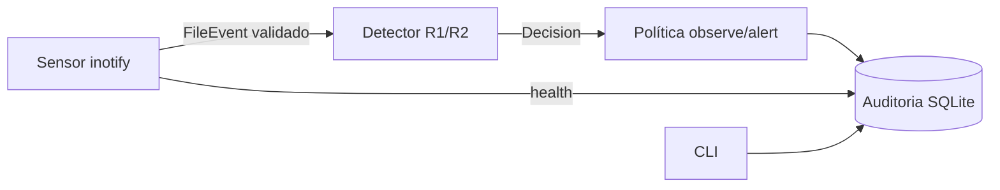

# Arquitetura, capacidades e ameaças (v0.1)

## Camadas e estado

| # | Camada | Implementação atual | Estado |
|---|---|---|---|
| 1 | Coletores nativos | `endguard/sensors/linux_inotify.py` (ctypes, sem privilégio) | implementado, testado localmente (Linux x86_64) |
| 2 | Canal autenticado + normalização | normalização em `schema.py`; **sem IPC** (processo único) | parcial — IPC entra junto com o executor privilegiado |
| 3 | Características/correlação | janela deslizante em `rules.py` | implementado |
| 4 | Regras + modelos locais | R1 (dano em massa), R2 (canário); ML no Marco C | regras implementadas; ML pendente |
| 5 | Políticas | modos observe/alert | parcial |
| 6 | Executor privilegiado | — | **não existe**; nenhuma resposta além de registrar/alertar |
| 7 | Auditoria local | SQLite 0600, trigger append-only | implementado (não resiste a admin/dono) |
| 8 | UI/admin | CLI (`python3 -m endguard.cli`) | CLI; PySide6 no Marco F |

LLMs (Opus/Sonnet/Haiku) só no desenvolvimento. Produção: regras e modelos locais, sem rede.

## Matriz de capacidades

| Plataforma | Fonte | Privilégio | Bloqueia antes? | Atribui processo? | Estado no projeto |
|---|---|---|---|---|---|
| Linux ≥5.x | inotify | nenhum | **não** (observacional) | **não** | implementado, testado nativo (Mint 22.3, kernel 7.0, x86_64) |
| Linux | fanotify `FAN_OPEN_PERM`/`FAN_ACCESS_PERM` (+`FAN_REPORT_FID`) | CAP_SYS_ADMIN | só na **abertura/acesso**; não medeia gravações em fd já aberto nem mmap | sim (pid; pidfd ≥5.15) | planejado; kernel local tem `CONFIG_FANOTIFY_ACCESS_PERMISSIONS=y`; **sem sudo nesta sessão** |
| Windows 10/11 | ETW (Kernel-File, Kernel-Process) | admin | não | sim | planejado; sem máquina Windows |
| Windows | minifilter (pre-write) | driver assinado (EV + atestação MS) | sim | sim | alto risco, componente separado; adiado |
| macOS 13+ | Endpoint Security (AUTH_OPEN/RENAME/UNLINK + NOTIFY_WRITE) | entitlement `com.apple.developer.endpoint-security.client`, assinatura, TCC FDA | AUTH sim, com prazo; escrita só NOTIFY | sim (audit token) | planejado; sem Mac nem entitlement |
| macOS | FSEvents | nenhum | não | não | modo limitado de fallback |

Fontes: man7.org fanotify(7)/inotify(7); learn.microsoft.com “About file system filter drivers”; developer.apple.com Endpoint Security.

## Limites de garantia (atuais)
- **Só detecção**, nunca prevenção: o alerta chega depois de ~20 arquivos alterados (ver `docs/validation.md`). Sem contenção, o dano continua.
- Sem atribuição de processo: atividade benigna concorrente soma na janela; não há como apontar/parar o culpado.
- Evasões conhecidas do R1 (abertas):
  - taxa abaixo de 20 ops destrutivas/10 s;
  - cifrar só parte do arquivo, mantendo baixa entropia nos primeiros 4 KiB;
  - arquivos < ~150 B (a entropia não chega a 7.2);
  - diluição da razão com escritas de baixa entropia;
  - wipers que só apagam (sem escrita de alta entropia o R1 não dispara; o R1 é voltado à criptografia);
  - arquivos fora da árvore vigiada e diretórios movidos para dentro dela (seus arquivos não geram eventos);
  - corrida entre `mkdir` e `add_watch`;
  - backlog: a entropia é amostrada na leitura do evento, e um arquivo já renomeado/apagado fica "unsampled" (fora da razão, mas ainda conta como destrutivo);
  - `close_write` sem `IN_MODIFY` (escrita via mmap, ou rename antes do close) só conta se a amostra tiver entropia alta;
  - um inode criado na sessão é "novo" por 60 s (TTL): criar e cifrar o próprio arquivo dentro desse prazo não conta como destrutivo. Limite aceito.
- Evasões corrigidas (regra v3):
  - tmp+rename por cima de arquivo não-novo;
  - alias por hardlink (`nlink>1` nunca é novo);
  - fases "renomeia tudo, espera, sobrescreve" (`rename_to` não concede novidade; ela segue o inode).
- Falsos positivos conhecidos: `gzip -r`/recompressão in-place; `rename_to` sem `rename_from` correspondente (mover de fora da árvore, alguns extratores/downloaders) conta como `replace`, porque o inotify não informa se o destino existia; abrir para escrita sem escrever um arquivo já de alta entropia (ex.: jpg) conta como sobrescrita.
- Limites do sensor: `IN_MODIFY` é coalescido por caminho; sem ele, o `close_write` sai marcado `no_modify_seen` (nunca é descartado). Se o conjunto de rastreamento enche (>100k arquivos abertos com escrita), ele é limpo e a saúde passa a degraded; diretório movido para fora da árvore mantém o watch com caminho antigo; um overflow deixa a saúde em degraded até reiniciar e entra na incerteza das decisões.
- Fora de alcance: kernel/firmware, rootkits, malware dormente, invasor com privilégio igual ou superior.

## Modelo de ameaças (resumo; detalhar no Marco A2)
| Ativo | Ameaça | Mitigação atual | Pendente |
|---|---|---|---|
| Leitura de conteúdo | symlink trocado (TOCTOU), FIFO para travar/derrubar o sensor | `O_NOFOLLOW|O_NONBLOCK`, `S_ISREG`, erros → None, só 4 KiB; o detector nunca lê disco (replay determinístico) | componentes intermediários do caminho ainda seguem symlink → usar o fd do evento (fanotify) |
| Auditoria | adulteração | 0600 (inclusive em DB pré-existente), `O_NOFOLLOW`, triggers impedem UPDATE/DELETE nas duas tabelas — barreira contra bugs, **não** contra o dono do arquivo | cadeia de hash; export remoto opcional |
| Simulador | uso contra dados reais | só (dev,inode) criados pelo próprio processo (registro em memória, não no disco), `O_NOFOLLOW`/`O_EXCL`, `st_nlink==1`, dono, lab 0700 direto em tmp, limites, bytes aleatórios | janela residual (mesmo uid): `remove`/`rename` por caminho após a verificação → usar `dir_fd` |
| Status | “protegido” falso | heartbeat; >30 s, relógio adiantado ou PID morto ⇒ degraded | ids por sensor quando houver vários watchers |
| Replay | evento hostil derruba/sonda | tipos estritos no schema; linha inválida é rejeitada e contada | assinatura de replays |
| Executor/IPC/atualização/ML | — | não existem ainda | revisar antes de existirem |
