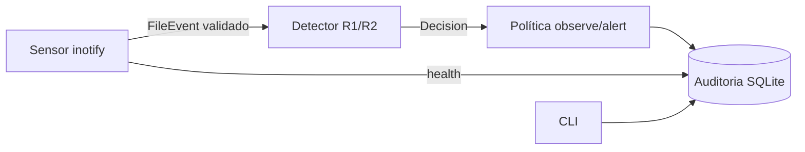

# Arquitetura, capacidades e ameaças (v0.1)

## Camadas e estado

| # | Camada | Implementação atual | Estado |
|---|---|---|---|
| 1 | Coletores nativos | `endguard/sensors/linux_inotify.py` (ctypes, sem privilégio) | implementado, testado localmente (Linux x86_64) |
| 2 | Canal autenticado + normalização | normalização em `schema.py`; **sem IPC** (processo único) | parcial — IPC entra junto com o executor privilegiado |
| 3 | Características/correlação | janela deslizante em `rules.py` | implementado |
| 4 | Regras + modelos locais | R1 (dano em massa), R2 (canário); ML no Marco C | regras implementadas; ML pendente |
| 5 | Políticas | modos observe/alert | parcial |
| 6 | Executor privilegiado | — | **não existe**; nenhuma resposta além de registrar/alertar |
| 7 | Auditoria local | SQLite 0600, trigger append-only | implementado (não resiste a admin/dono) |
| 8 | UI/admin | CLI (`python3 -m endguard.cli`) | CLI; PySide6 no Marco F |

LLMs (Opus/Sonnet/Haiku) só no desenvolvimento. Produção: regras e modelos locais, sem rede.

## Matriz de capacidades

| Plataforma | Fonte | Privilégio | Bloqueia antes? | Atribui processo? | Estado no projeto |
|---|---|---|---|---|---|
| Linux ≥5.x | inotify | nenhum | **não** (observacional) | **não** | implementado, testado nativo (Mint 22.3, kernel 7.0, x86_64) |
| Linux | fanotify `FAN_OPEN_PERM`/`FAN_ACCESS_PERM` (+`FAN_REPORT_FID`) | CAP_SYS_ADMIN | só na **abertura/acesso**; não medeia gravações em fd já aberto nem mmap | sim (pid; pidfd ≥5.15) | planejado; kernel local tem `CONFIG_FANOTIFY_ACCESS_PERMISSIONS=y`; **sem sudo nesta sessão** |
| Windows 10/11 | ETW (Kernel-File, Kernel-Process) | admin | não | sim | planejado; sem máquina Windows |
| Windows | minifilter (pre-write) | driver assinado (EV + atestação MS) | sim | sim | alto risco, componente separado; adiado |
| macOS 13+ | Endpoint Security (AUTH_OPEN/RENAME/UNLINK + NOTIFY_WRITE) | entitlement `com.apple.developer.endpoint-security.client`, assinatura, TCC FDA | AUTH sim, com prazo; escrita só NOTIFY | sim (audit token) | planejado; sem Mac nem entitlement |
| macOS | FSEvents | nenhum | não | não | modo limitado de fallback |

Fontes: man7.org fanotify(7)/inotify(7); learn.microsoft.com “About file system filter drivers”; developer.apple.com Endpoint Security.

## Limites de garantia (atuais)
- **Só detecção**, nunca prevenção: o alerta chega depois de ~20 arquivos alterados (ver `docs/validation.md`). Sem contenção, o dano continua.
- Sem atribuição de processo: atividade benigna concorrente soma na janela; não há como apontar/parar o culpado.
- Evasão conhecida: taxa abaixo de 20 ops destrutivas/10 s; criptografia parcial com baixa entropia na amostra de 4 KiB; arquivos fora da árvore vigiada; diretórios criados entre `mkdir` e o add_watch (corrida).
- Falso positivo conhecido: `gzip -r`/recompressão in-place.
- Fora de alcance: kernel/firmware, rootkits, malware dormente, invasor com privilégio igual ou superior.

## Modelo de ameaças (resumo; detalhar no Marco A2)
| Ativo | Ameaça | Mitigação atual | Pendente |
|---|---|---|---|
| Fluxo de eventos | evento malformado/injetado via replay | schema estrito (campos, ação, NUL, tamanho, versão) | assinatura de replays |
| Leitura de conteúdo | symlink trocado entre evento e amostra (TOCTOU) | `O_NOFOLLOW|O_NONBLOCK`, só 4 KiB | descritor do próprio evento (fanotify) |
| Auditoria | adulteração | 0600 + trigger append-only | cadeia de hash; export remoto opcional |
| Simulador | uso contra dados reais | só arquivos que criou, em tmp com marcador, limites de qtd/bytes/tempo, bytes aleatórios | — |
| Status | “protegido” falso | heartbeat; >30 s sem heartbeat ⇒ degraded | — |
| Executor/IPC/atualização/ML | — | não existem ainda | revisar antes de existirem |
